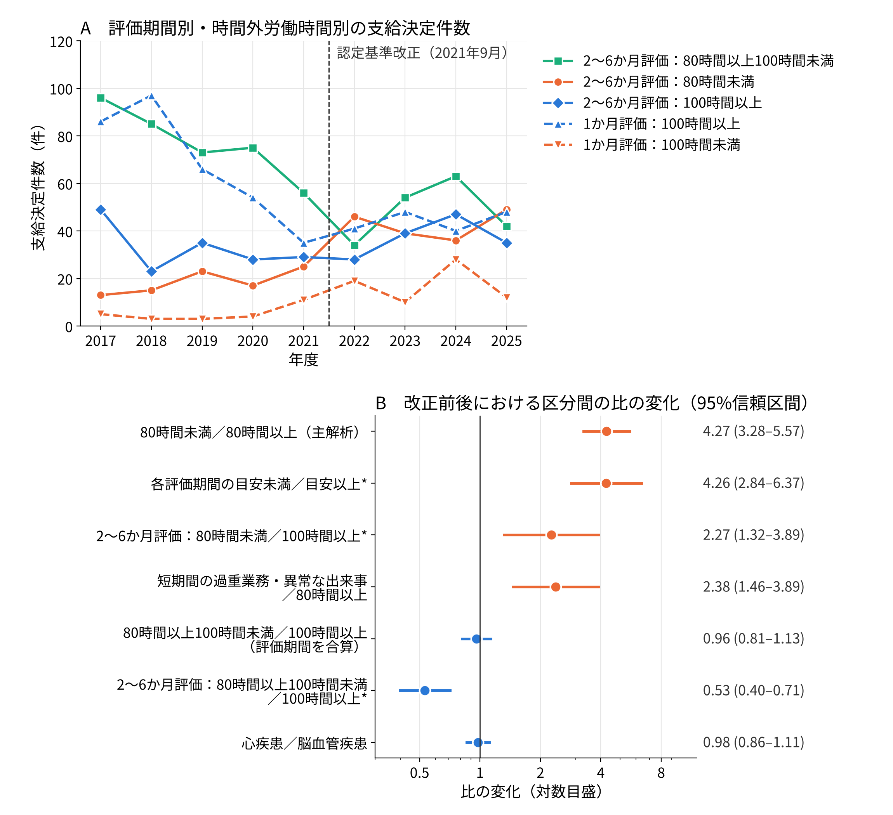

# 補足資料

労災認定基準の改正に伴う過労死等支給決定の内訳の変化：2009〜2025年度の全国統計の分析

上松 弘典（うえまつ産業医事務所〔メステート合同会社〕）

補足表S1〜S9および補足図S1を収める．年度は4月から翌年3月までを指す．CI は信頼区間，RR は水準比，OR はオッズ比である．

## 補足表S1．認定基準の改正内容

| 改正 | 主な内容 |
|---|---|
| 脳・心臓疾患，2021年9月14日（9月15日から適用） | 時間外労働の目安（発症前1か月間におおむね100時間，または発症前2〜6か月間に1か月当たりおおむね80時間）は維持された．目安に近い時間外労働が認められる場合には，労働時間以外の負荷要因と総合的に評価して業務起因性を認め得ることが明確化された．労働時間以外の負荷要因として，勤務間インターバルが短い勤務（おおむね11時間未満），休日のない連続勤務，身体的負荷を伴う業務，事業場外における移動を伴う業務（出張以外）が追加された．短期間の過重業務および異常な出来事の基準が明確化され，対象疾病に重篤な心不全が追加された． |
| 精神障害，2011年12月26日 | 1999年の判断指針に代えて認定基準が策定された．業務による心理的負荷評価表が定められ，極度の長時間労働（発症直前の1か月におおむね160時間以上の時間外労働など）は，それのみで心理的負荷を「強」と評価し得るとされた．専門部会での協議は，判断が難しい事案に限られた． |
| 精神障害，2020年5月29日（6月1日から適用） | パワーハラスメント防止措置の法制化を受けて，心理的負荷評価表に「パワーハラスメント」の出来事が追加された． |
| 精神障害，2023年9月1日 | 顧客等からの著しい迷惑行為（いわゆるカスタマーハラスメント）が追加され，ハラスメントの具体例が拡充された．既存の精神障害の悪化について業務起因性を認める範囲が広げられた．専門部会での協議を要する事案が減り，専門医1名の意見で決定できる事案が増えた． |

## 補足表S2．データの出典（系列別・年度別）

公開リポジトリ（https://github.com/mestate-academic/recognition-criteria-revisions-japan）のデータファイルごとに出典を示す．ファイルはすべて UTF-8 の CSV である．

- 請求件数は請求のあった年度，決定件数および支給決定件数は決定のあった年度で集計されている．
- 請求件数は，業務災害としての請求と，2020年9月に新設された複数業務要因災害として判断される請求を区別していない．決定件数および支給決定件数には，別に集計されている複数業務要因災害を含まない．
- 以下の系列の数値は `code/build_data.py` に，出典および照合の注記とともに記録している．出来事別件数とその群への割り当ては `code/build_events.py` に記録した（補足表S9）．
- 特に断らない限り，出典は厚生労働省「過労死等の労災補償状況」（以下，年次資料）の別添資料1（脳・心臓疾患）および別添資料2（精神障害）である．各年度版には当該年度と前年度の数値が掲載されており，重複する年度の数値は相互に照合した．

### (1) 脳・心臓疾患の全国総数（`cvd_national.csv`，2001〜2025年度）

変数：請求件数，決定件数，支給決定件数（それぞれ死亡を内数として含む）．

| 年度 | 変数 | 出典 |
|---|---|---|
| 2001〜2019 | 請求件数，支給決定件数 | 厚生労働省．第2回脳・心臓疾患の労災認定の基準に関する専門検討会 資料1（2020年）表1（https://www.mhlw.go.jp/content/11201000/000650614.pdf） |
| 2008〜2012 | 決定件数 | 大阪労働局 報道発表資料（2013年6月27日）表1-1（全国の列） |
| 2013 | 決定件数 | 年次資料 平成29年度版 表1-1 |
| 2014〜2018 | 決定件数 | 年次資料 平成30年度版 表1-1 |
| 2019〜2025 | 全変数 | 年次資料 令和5年度版および令和7年度版 表1-1（2020〜2024年度は令和6年度版とも照合） |

### (2) 脳・心臓疾患の時間外労働時間別支給決定件数（`cvd_overtime_bands.csv`，2007〜2025年度）

区分：評価期間における1か月平均の時間外労働時間（45時間未満，45〜60時間未満，60〜80時間未満，80〜100時間未満，100〜120時間未満，120〜140時間未満，140〜160時間未満，160時間以上），および「その他」（短期間の過重業務・異常な出来事）．評価期間は，合算（1か月評価と2〜6か月評価の合計），1か月評価，2〜6か月評価の別に記録した．

| 年度 | 評価期間 | 出典 |
|---|---|---|
| 2007〜2019 | 合算 | 上記の専門検討会資料1（2020年）表5 |
| 2017〜2025 | 1か月評価，2〜6か月評価 | 年次資料 表1-6：平成30年度版（2017〜2018年度），令和2年度版（2019〜2020年度），令和4年度版（2021年度），令和5年度版（2022〜2023年度），令和7年度版（2024〜2025年度） |
| 2020〜2025 | 合算 | 1か月評価と2〜6か月評価の合計 |

行の順序は，最も件数の多い区分を記載した各年度版の本文と照合した．すべての年度で，合算の合計は (1) の支給決定件数と一致する．

### (3) 脳・心臓疾患の疾病別件数（`cvd_by_type.csv`）

区分：脳血管疾患，虚血性心疾患等（2021年9月以降は重篤な心不全を含む）．

| 年度 | 変数 | 出典 |
|---|---|---|
| 2001〜2019 | 支給決定件数 | 上記の専門検討会資料1（2020年）表6 |
| 2020，2022〜2025 | 全変数 | 年次資料 表1-5（合計の行） |
| 2021 | 支給決定件数 | 令和6年版過労死等防止対策白書 第4-1-1-4図 |

### (4) 精神障害の全国総数（`mental_national.csv`，1999〜2025年度．決定件数は2009年度以降）

変数：請求件数，決定件数，支給決定件数，およびそれぞれの自殺（未遂を含む）の件数（2009〜2025年度）．

- 1999〜2020年度：厚生労働省．第1回精神障害の労災認定の基準に関する専門検討会 資料2（2021年12月）（https://www.mhlw.go.jp/content/11201000/000862995.pdf）
- 2019〜2025年度：年次資料 別添資料2 表2-1（令和5年度版および令和7年度版）

### (5) 精神障害の時間外労働時間別支給決定件数（`mental_overtime_bands.csv`，2017〜2025年度）

区分：心理的負荷の評価期間における1か月平均の時間外労働時間（20時間未満から160時間以上までの9区分），および「その他」．「その他」は時間外労働時間が示されていない区分であり，公的な説明は資料によって異なる（本文「2　方法」参照）．

| 年度 | 出典（特に断らない限り年次資料 表2-6） |
|---|---|
| 2017〜2018 | 平成30年度版 |
| 2019 | 令和元年度版 |
| 2020 | 専門検討会資料2（2021年） |
| 2021 | 令和4年度版 |
| 2022〜2023 | 令和5年度版 |
| 2024〜2025 | 令和7年度版 |

2020〜2024年度は令和6年度版の表2-1および表2-6とも照合した．各年度の合計は (4) の支給決定件数と一致する．

### (6) 精神障害の請求から決定までの平均処理期間（`mental_processing_time.csv`，2007〜2024年度）

| 年度 | 出典と換算 |
|---|---|
| 2007〜2020 | 専門検討会資料2（2021年）第8項．月数で示されており，同資料の換算に従って「月数×30」で日数に換算した． |
| 2021〜2024 | 厚生労働省．政策評価の事前分析表（施策目標Ⅲ-3-1，令和6年度および令和7年度実施施策）の処理期間に関する測定指標．日数で示されている． |

2020年度（255日）は両資料で一致する．

### (7) 精神障害の出来事別件数（`mental_events.csv`，2017〜2025年度）

年次資料 表2-8（2017，2018，2021〜2025年度），令和2年版過労死等防止対策白書（https://www.mhlw.go.jp/wp/hakusyo/karoushi/20/dl/hakusho-zentai.pdf）第1-23表（2019年度），専門検討会資料2（2021年）（2020年度）による．2022年度は，令和5年度版で2023年改正後の項目に組み替えて再掲された数値を用いた．

### (8) 関連リポジトリと共通のファイル

時間外労働の上限規制と精神障害の労災請求に関する著者の別の研究（https://github.com/mestate-academic/overtime-caps-mental-disorders-japan）と同じ手順で転記したファイルを含む．このうち本研究で用いたのは，(4) の元データである `rosai_mental_national.csv`（年次資料 表2-1）のみである．業種別の件数および就業者数のファイルは，本研究では用いていない．

## 補足表S3．分割時系列解析の感度分析

| 改正／モデル | 請求件数 RR（95% CI） | 支給決定件数 RR（95% CI） | 支給決定割合 OR（95% CI） |
|---|---|---|---|
| 脳・心臓疾患：主モデル（2009〜2025年度） | 1.13 (0.93–1.36) | 1.11 (0.93–1.33) | 1.17 (0.90–1.51) |
| 脳・心臓疾患：解析期間を2014〜2025年度に変更 | 0.97 (0.74–1.27) | 1.15 (0.92–1.44) | 1.59 (1.28–1.97) |
| 脳・心臓疾患：解析期間を2017〜2025年度に変更 | 0.86 (0.57–1.30) | 1.08 (0.75–1.56) | 1.96 (1.71–2.25) |
| 脳・心臓疾患：トレンドなし（2009〜2025年度） | 1.24 (1.11–1.39) | 0.81 (0.68–0.96) | 0.71 (0.55–0.91) |
| 精神障害，2023年改正：主モデル | 1.43 (1.26–1.63) | 1.54 (1.37–1.74) | 0.94 (0.81–1.08) |
| 精神障害，2023年改正：2023年度を0.5として扱う | 1.42 (1.24–1.63) | 1.54 (1.37–1.73) | 0.93 (0.79–1.09) |
| 精神障害，2023年改正：2023年度を改正後として扱う | 1.38 (1.22–1.55) | 1.44 (1.26–1.64) | 1.00 (0.86–1.17) |
| 精神障害，2023年改正：2016〜2025年度，2023年改正の指示変数のみ | 1.32 (1.09–1.60) | 1.35 (1.15–1.59) | 0.85 (0.68–1.06) |
| 精神障害，2023年改正：2020年度以降の傾きの変化を許容 | 1.00 (0.85–1.18) | 1.32 (1.02–1.71) | 0.74 (0.55–1.00) |
| 精神障害，2023年改正：変換後の値に対する最小二乗法（Newey-West 標準誤差，ラグ1） | 1.45 (1.26–1.67) | 1.54 (1.42–1.66) | 0.94 (0.83–1.06) |
| 精神障害：プラセボ解析（2014〜2019年度開始） | 0.94–1.07 | 0.90–1.04 | 0.84–1.07 |

注：2016〜2025年度のモデルは，線形トレンドと2024年度以降の指示変数を含み，2020年度以降の指示変数を含まない．したがって，解析期間と改正の扱いの両方が主モデルと異なる．最小二乗法による感度分析では，件数の対数および支給決定割合のロジットを目的変数とし，線形トレンドと3回の改正の指示変数を含めた．精神障害のプラセボ解析では，2009〜2019年度を対象に，2012年度以降の指示変数と線形トレンドを含むモデルへ，2014〜2019年度の各年度を開始時点とする仮想の指示変数を1つずつ加えた（件数は擬似ポアソン回帰，支給決定割合は擬似二項回帰）．6つの推定値の範囲を示す．

## 補足表S4．評価期間別の比較（目安未満／目安以上）の感度分析：2017〜2020年度に対する2022〜2025年度

| モデル | 比の変化（95% CI） |
|---|---|
| 擬似ポアソン回帰，年度固定効果（補足表S7） | 4.26 (2.84–6.37) |
| 年度でクラスター化した標準誤差 | 4.26 (2.40–7.55) |
| 区分別線形トレンド | 3.60 (1.25–10.35) |
| 区分別線形トレンドおよび年度でクラスター化した標準誤差 | 3.60 (0.50–25.87) |
| 年次の対数比，線形トレンド付き最小二乗法（Newey-West 標準誤差，ラグ1） | 2.88 (1.31–6.32) |

注：対象は8年度である（2021年度を除外）．クラスター数が8と少ないため，クラスター頑健な信頼区間の算出に用いた正規近似は信頼性が低い可能性がある．いずれも事後的・探索的な解析である．

## 補足表S5．主解析（月80時間未満／月80時間以上）の感度分析

| モデル | 比の変化（95% CI） |
|---|---|
| 主解析（2009〜2020年度に対する2022〜2025年度） | 4.27 (3.28–5.57) |
| 区分別線形トレンドの追加 | 3.81 (2.22–6.53) |
| 年度でクラスター化した標準誤差 | 4.27 (2.95–6.20) |
| 区分別線形トレンドの追加および年度でクラスター化した標準誤差 | 3.81 (1.73–8.37) |
| 年次の対数比，線形トレンド付き最小二乗法（Newey-West 標準誤差，ラグ1） | 3.88 (2.33–6.48) |
| 改正前期間を2015〜2020年度に短縮 | 4.54 (3.11–6.63) |
| 2009年度を除外 | 4.21 (3.20–5.54) |
| 2010年度を除外 | 4.27 (3.23–5.65) |
| 2011年度を除外 | 4.30 (3.25–5.69) |
| 2012年度を除外 | 4.22 (3.20–5.56) |
| 2013年度を除外 | 4.51 (3.51–5.79) |
| 2014年度を除外 | 4.28 (3.23–5.66) |
| 2015年度を除外 | 4.15 (3.19–5.39) |
| 2016年度を除外 | 4.18 (3.19–5.46) |
| 2017年度を除外 | 4.15 (3.19–5.40) |
| 2018年度を除外 | 4.24 (3.21–5.59) |
| 2019年度を除外 | 4.46 (3.48–5.72) |
| 2020年度を除外 | 4.36 (3.32–5.73) |
| 2022年度を除外 | 4.01 (3.01–5.34) |
| 2023年度を除外 | 4.50 (3.37–6.01) |
| 2024年度を除外 | 4.60 (3.46–6.12) |
| 2025年度を除外 | 4.03 (3.01–5.40) |

注：特に断らない限り，年度固定効果を含む擬似ポアソン回帰による．2021年度はすべてのモデルで除外した．1年度ずつ除外した16モデルの推定値の範囲は4.01〜4.60，感度分析全体では3.81〜4.60であった．

## 補足表S6．改正前の期間内におけるプラセボ解析（月80時間未満／月80時間以上）

| 仮想の改正後期間／比較期間 | 比の変化（95% CI） |
|---|---|
| A．4年間の仮想改正後期間（表示した年度のデータのみを使用） | |
| 2012〜2015年度／2009〜2011年度 | 1.06 (0.70–1.62) |
| 2013〜2016年度／2009〜2012年度 | 1.06 (0.72–1.57) |
| 2014〜2017年度／2009〜2013年度 | 0.74 (0.53–1.02) |
| 2015〜2018年度／2009〜2014年度 | 0.71 (0.53–0.94) |
| 2016〜2019年度／2009〜2015年度 | 0.95 (0.63–1.42) |
| 2017〜2020年度／2009〜2016年度 | 1.12 (0.77–1.62) |
| B．仮想改正時点以降の全年度（2009〜2020年度のデータを使用） | |
| 2012〜2020年度／2009〜2011年度 | 1.05 (0.71–1.57) |
| 2013〜2020年度／2009〜2012年度 | 1.10 (0.77–1.58) |
| 2014〜2020年度／2009〜2013年度 | 0.90 (0.64–1.28) |
| 2015〜2020年度／2009〜2014年度 | 0.90 (0.63–1.28) |
| 2016〜2020年度／2009〜2015年度 | 1.00 (0.70–1.45) |
| 2017〜2020年度／2009〜2016年度 | 1.12 (0.77–1.62) |
| 2018〜2020年度／2009〜2017年度 | 1.33 (0.92–1.93) |

注：改正前の年度（2009〜2020年度）のみに当てはめた，年度固定効果を含む擬似ポアソン回帰による．「2017〜2020年度／2009〜2016年度」は，AとBで同一のモデルである．

## 補足表S7．脳・心臓疾患の評価期間別・時間外労働時間別の支給決定件数（2017〜2025年度）

| 年度 | 1か月評価：100時間以上 | 1か月評価：100時間未満 | 2〜6か月評価：100時間以上 | 2〜6か月評価：80時間以上100時間未満 | 2〜6か月評価：80時間未満 | 短期間の過重業務・異常な出来事 | 目安未満の割合（%） |
|---|---:|---:|---:|---:|---:|---:|---:|
| 2017 | 86 | 5 | 49 | 96 | 13 | 4 | 7.1 |
| 2018 | 97 | 3 | 23 | 85 | 15 | 15 | 7.6 |
| 2019 | 66 | 3 | 35 | 73 | 23 | 16 | 12.0 |
| 2020 | 54 | 4 | 28 | 75 | 17 | 16 | 10.8 |
| 2021 | 35 | 11 | 29 | 56 | 25 | 16 | 20.9 |
| 2022 | 41 | 19 | 28 | 34 | 46 | 26 | 33.5 |
| 2023 | 48 | 10 | 39 | 54 | 39 | 26 | 22.7 |
| 2024 | 40 | 28 | 47 | 63 | 36 | 27 | 26.6 |
| 2025 | 48 | 12 | 35 | 42 | 49 | 31 | 28.1 |
| 2017〜2020年度の平均 | 75.8 | 3.8 | 33.8 | 82.3 | 17.0 | 12.8 | |
| 2022〜2025年度の平均 | 44.3 | 17.3 | 37.3 | 48.3 | 42.5 | 27.5 | |

| 比較した区分（分子／分母），2017〜2020年度に対する2022〜2025年度 | 比の変化（95% CI） |
|---|---|
| 各評価期間の目安未満／目安以上 | 4.26 (2.84–6.37) |
| 1か月評価：100時間未満／100時間以上 | 7.87 (3.32–18.65) |
| 2〜6か月評価：80時間未満／80時間以上 | 3.39 (1.98–5.81) |
| 2〜6か月評価：80時間未満／100時間以上 | 2.27 (1.32–3.89) |
| 2〜6か月評価：80時間以上100時間未満／100時間以上 | 0.53 (0.40–0.71) |

注：目安は，発症前1か月間におおむね100時間，または発症前2〜6か月間に1か月当たりおおむね80時間の時間外労働である．目安未満の割合は，1か月評価の100時間未満と2〜6か月評価の80時間未満の合計を，短期間の過重業務・異常な出来事を含む支給決定件数全体で除して求めた．比の変化は，年度固定効果を含む擬似ポアソン回帰による推定値であり，2021年度を除外した．「各評価期間の目安未満／目安以上」の分母は，それぞれの評価期間の目安以上の件数である．その他の比較の分母は，行の見出しに示した区分である．短期間の過重業務・異常な出来事による支給決定は，これらのモデルに含めていない．評価期間別の表は2017年度から公表されている．いずれも事後的・探索的な解析であり，感度分析は補足表S4に示す．

## 補足表S8．精神障害の時間外労働時間別の支給決定件数と平均処理期間（2017〜2025年度）

| 年度 | 支給決定件数 | 月80時間以上 | 月80時間未満 | 「その他」の区分，件数（%） | 請求から決定までの平均処理期間（日） |
|---|---:|---:|---:|---:|---:|
| 2017 | 506 | 184 | 178 | 144 (28.5) | 216 |
| 2018 | 465 | 177 | 176 | 112 (24.1) | 219 |
| 2019 | 509 | 182 | 167 | 160 (31.4) | 240 |
| 2020 | 608 | 150 | 179 | 279 (45.9) | 255 |
| 2021 | 629 | 158 | 166 | 305 (48.5) | 251 |
| 2022 | 710 | 149 | 201 | 360 (50.7) | 261 |
| 2023 | 883 | 174 | 181 | 528 (59.8) | 278 |
| 2024 | 1056 | 227 | 214 | 615 (58.2) | 277 |
| 2025 | 1082 | 171 | 212 | 699 (64.6) | — |

| 比較した区分（分子／分母） | 2020年改正後（95% CI） | 2023年改正後の追加的な変化（95% CI） |
|---|---|---|
| 「その他」の区分／月80時間以上 | 2.70 (1.90–3.82) | 1.60 (1.15–2.21) |
| 月80時間未満／月80時間以上 | 1.25 (1.02–1.52) | 0.90 (0.72–1.11) |

注：—は，2026年11月18日時点で参照した資料に掲載がないことを示す．「その他」の区分は，年次資料の脚注では，出来事による心理的負荷が極度であると認められる事案など，労働時間の調査を行わずに業務上と判断された事案等と説明されている．一方，2017・2018年度の同じ件数を掲載した専門検討会資料（2019年）には，時間外労働時間の報告がない事案をこの区分に計上している旨の記載がある．いずれにしても，この区分では時間外労働時間が示されていない．時間外労働時間は，心理的負荷の評価期間における1か月平均である．比の変化は，年度固定効果を含む擬似ポアソン回帰による推定値であり，2023年度を除外した．2017〜2020年度の処理期間は月数で公表されており，「月数×30」で日数に換算した概数である．2021〜2024年度は日数で公表されている．

## 補足表S9．精神障害の出来事群別および主な項目別の決定件数と支給決定件数（2017〜2025年度）

数値は「決定件数/支給決定件数」である．

| 年度 | ハラスメント・いじめ・暴行 | その他の対人関係トラブル | 仕事量・質 | 事故・災害 | 仕事の失敗・過重な責任 | 役割・地位の変化 | 特別な出来事 | その他の出来事 | 計 |
|---|---:|---:|---:|---:|---:|---:|---:|---:|---:|
| 2017 | 250/123 | 397/24 | 322/154 | 185/89 | 125/32 | 127/21 | 63/63 | 76/0 | 1545/506 |
| 2018 | 232/102 | 350/23 | 303/140 | 178/92 | 126/29 | 123/24 | 55/55 | 94/0 | 1461/465 |
| 2019 | 258/121 | 408/29 | 327/143 | 166/83 | 136/39 | 126/31 | 63/63 | 102/0 | 1586/509 |
| 2020 | 398/214 | 496/23 | 310/130 | 247/133 | 134/31 | 133/23 | 54/54 | 134/0 | 1906/608 |
| 2021 | 465/246 | 587/25 | 276/140 | 189/98 | 123/30 | 146/27 | 63/63 | 104/0 | 1953/629 |
| 2022 | 507/286 | 601/28 | 265/139 | 218/131 | 123/43 | 130/22 | 61/61 | 81/0 | 1986/710 |
| 2023 | 646/371 | 771/33 | 395/170 | 280/158 | 160/46 | 174/34 | 71/71 | 86/0 | 2583/883 |
| 2024 | 888/481 | 1211/45 | 520/210 | 246/135 | 190/58 | 267/49 | 79/78 | 95/0 | 3496/1056 |
| 2025 | 1009/538 | 1386/47 | 508/183 | 289/153 | 203/52 | 279/35 | 74/74 | 91/0 | 3839/1082 |

| 年度 | パワーハラスメント | 暴行又はひどいいじめ・嫌がらせ | セクシュアルハラスメント | 顧客等からの著しい迷惑行為 | 上司とのトラブル | 月80時間以上の時間外労働 |
|---|---:|---:|---:|---:|---:|---:|
| 2017 | — | 186/88 | 64/35 | — | 320/22 | 61/41 |
| 2018 | — | 178/69 | 54/33 | — | 255/18 | 68/45 |
| 2019 | — | 174/79 | 84/42 | — | 294/21 | 54/32 |
| 2020 | 180/99 | 128/71 | 90/44 | — | 388/14 | 52/31 |
| 2021 | 242/125 | 126/61 | 97/60 | — | 451/17 | 36/28 |
| 2022 | 257/147 | 148/73 | 102/66 | — | 475/23 | 27/21 |
| 2023 | 289/157 | 118/59 | 156/103 | 83/52 | 599/21 | 61/35 |
| 2024 | 389/224 | 101/44 | 191/105 | 207/108 | 953/38 | 88/51 |
| 2025 | 403/222 | 133/62 | 233/127 | 240/127 | 1061/36 | 90/40 |

注：公表資料では，決定された事案ごとに出来事が1項目計上されており，その合計は各年度の決定件数および支給決定件数の総数と一致する．出典は補足表S2 (7) に示した．出来事の項目は，2020年6月（パワーハラスメントの追加）と2023年9月（顧客等からの著しい迷惑行為の追加，その他の項目の統合）に変更された．各群の構成は次のとおりである．ハラスメント・いじめ・暴行群：パワーハラスメント，暴行又はひどいいじめ・嫌がらせ（2020年6月より前は「（ひどい）嫌がらせ，いじめ，又は暴行を受けた」），セクシュアルハラスメント，顧客等からの著しい迷惑行為．その他の対人関係トラブル群：出来事の類型「対人関係」の残りの項目．事故・災害群，仕事の失敗・過重な責任群，仕事量・質群，役割・地位の変化群：それぞれ認定基準の出来事の類型1，2，3，4．特別な出来事群：心理的負荷が極度のもの，および極度の長時間労働．その他の出来事：公表資料の「その他」の行であり，評価の対象となる出来事が認められなかった事案等を含む．—は，その年度に当該項目がなかったことを示す．項目別の全件数と各項目の群への割り当ては，公開リポジトリの `data/mental_events.csv` および `code/build_events.py` に収めている．

## 補足図S1．脳・心臓疾患の評価期間別の支給決定件数と，改正前後における区分間の比の変化

A：評価期間別・時間外労働時間別の支給決定件数（2017〜2025年度）．実線は2〜6か月評価（目安は1か月当たりおおむね80時間），破線は1か月評価（目安はおおむね100時間）である．縦の破線は2021年9月の認定基準改正を表す．B：年度の固定効果を含む擬似ポアソン回帰により推定した，改正前後における区分間の支給決定件数の比の変化と95%信頼区間．橙色は，目安未満の区分または短期間の過重業務・異常な出来事を分子とする比較，青色はその他の比較である．アスタリスク（*）を付した比較は評価期間別の表を用い，2017〜2020年度に対する2022〜2025年度の変化を示す．それ以外は2009〜2020年度に対する2022〜2025年度の変化であり，時間外労働時間別の比較では両評価期間を合算し，心疾患と脳血管疾患の比較では疾病別の件数を用いた．

